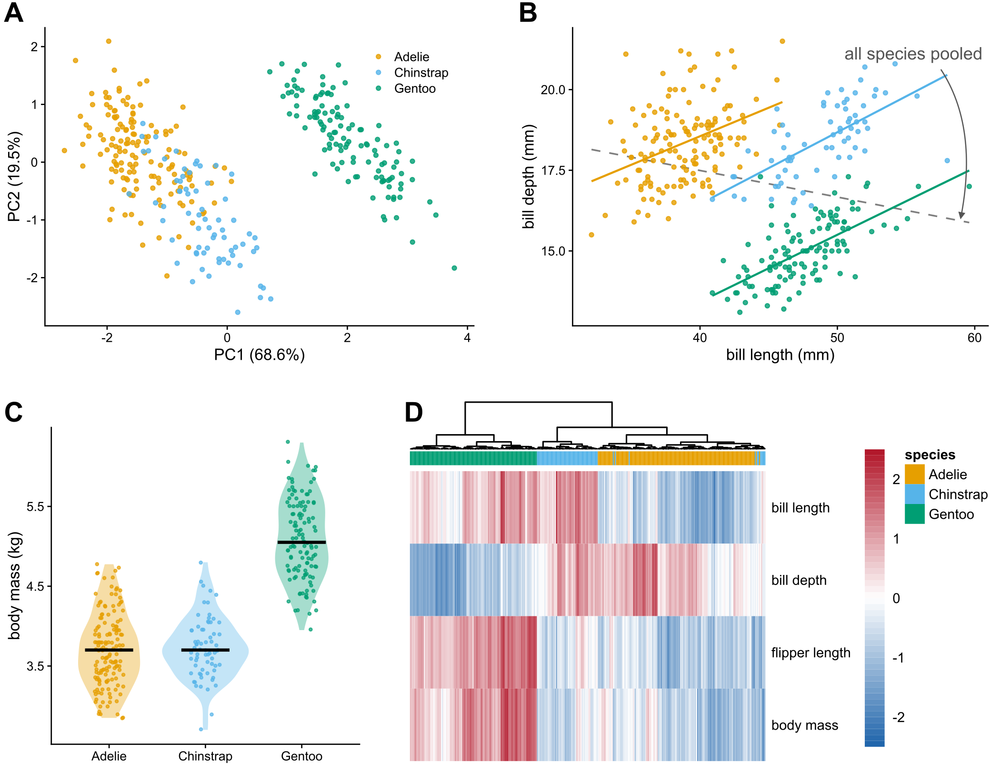
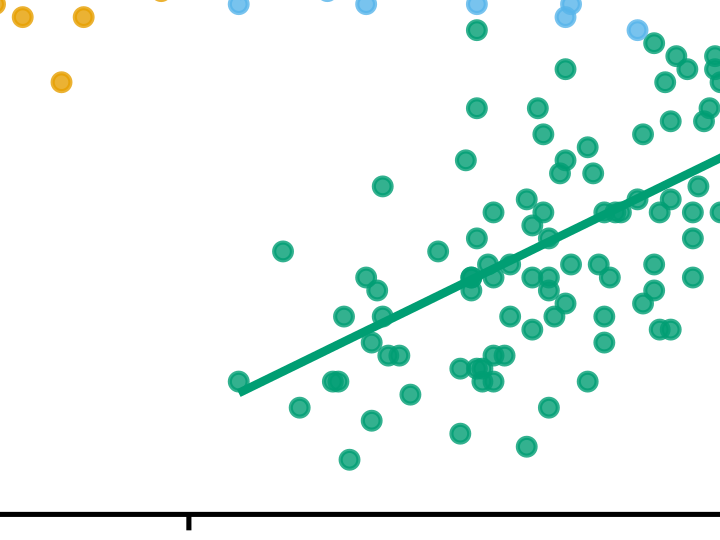
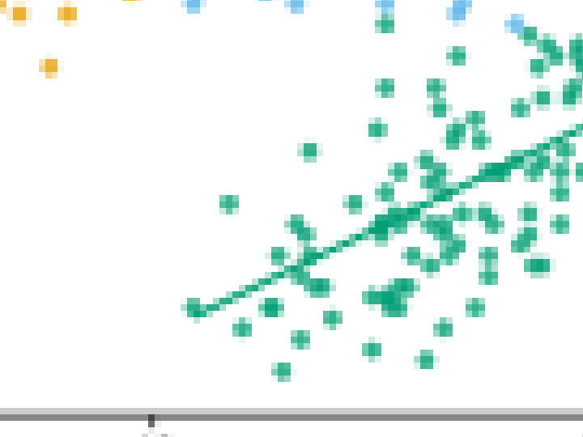

# building-figures-inkscape

My practice for the McGill MiCM workshop [Building figures with Inkscape](https://github.com/QLS-MiCM/Fall-2026-Bootcamp-Building-figures-with-Inkscape) (October 2026). The workshop shows how to turn separate plots into one publication-ready multi-panel figure. Here I make the panels in R as vector files, then assemble them into a single SVG with Inkscape layers, so the last touches can be done by hand in Inkscape.

The data is the Palmer penguins dataset rather than the workshop's mock RNA-seq outputs.



## Run

```r
# from the repo root, rebuilds panels/ and figure/
source("run_all.R")
```

Built with R 4.6.1. `run_all.R` installs any missing packages.

| Script | What it does |
|---|---|
| `R/01_panels.R` | one SVG per panel (`panels/A.svg` to `D.svg`), saved at its final size |
| `R/02_assemble.R` | places the panels on a 7 in wide page, adds panel letters and the arrow in B, writes `figure/figure_1.svg`, `.pdf` and a 300 dpi `.png` |
| `R/03_vector_vs_raster.R` | zooms into panel B from the SVG and from a 72 dpi PNG |

## Finishing in Inkscape

`figure/figure_1.svg` has one layer per panel, plus a layer for the panel letters and one for annotations. Text is kept as text, so labels can still be edited. Things left to do by hand in Inkscape:

- Object > Align and Distribute to line up panel edges
- Layers and Objects panel to lock the panels while moving annotations
- File > Export (PNG at 300 dpi or more), or Save a Copy as PDF for the journal

## Vector vs raster

Same corner of panel B, zoomed in. Left from the SVG, right from a 72 dpi PNG:

<p>
  
  
</p>

## Notes from the workshop

- Keep plots as vectors (SVG or PDF) until the very end. Rasterise only for the final export, at 300 dpi or more (higher for line art).
- PNG and TIFF are raster. PDF and SVG are vector, but they can hide a raster inside, for example a heatmap exported as an image.
- Save each plot at its final size, so the text is the same size in every panel (about 6 to 8 pt) and nothing gets stretched.
- One font, one set of colours and one line width for the whole figure. Use colour-blind safe palettes.
- Group and layer things, lock what is finished, and use guides with Align and Distribute instead of placing by eye.
- Clipping and masking crop things without deleting the data underneath.
- Check the journal's rules for width (single column is about 3.5 in, double about 7 in), file format and fonts.
